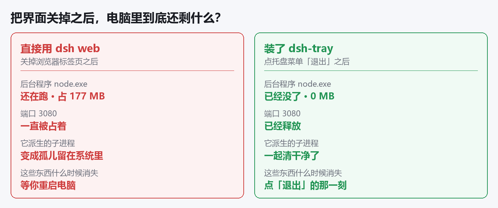
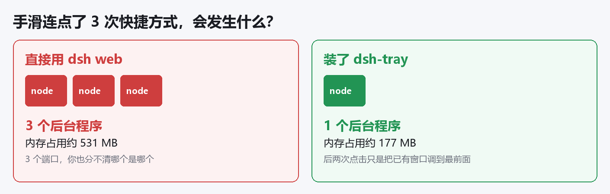
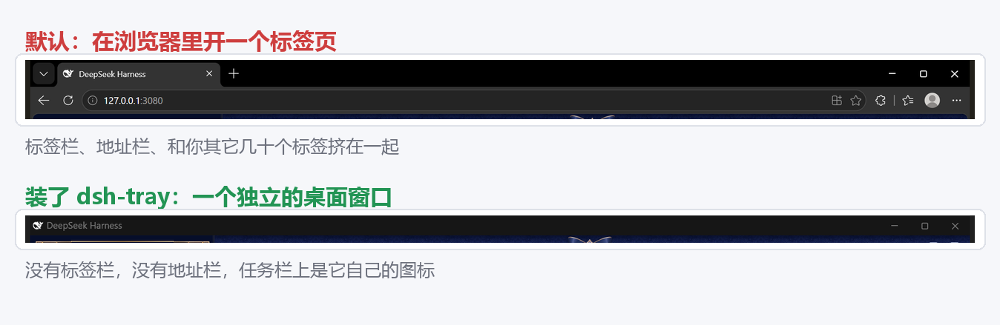
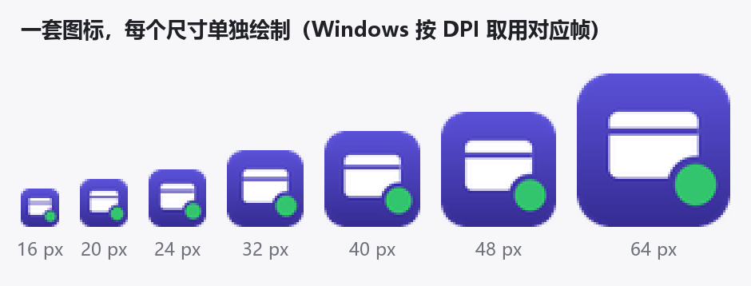
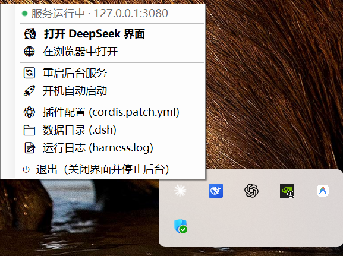

# dsh-tray-windows

让 [DeepSeek Harness](https://github.com/deepseek-ai/deepseek-harness)（`dsh web`）在 Windows 上**像一个正常的桌面软件**：桌面上一个图标，点开就用，关掉就是真的关掉。

> 非官方项目，与 DeepSeek 官方无关。图标为原创，不含任何 DeepSeek 商标。

---

## 一、你以为关掉了，其实它还在跑

这是最要命的一个问题。

DeepSeek Harness 的界面其实就是个网页。**你随手把窗口一关，看起来像是关掉了 —— 但真正干活的那个程序还在后台跑着**，你在屏幕上完全看不见它。

它会一直占着你的内存（实测：什么都不干、刚打开的状态就占 **177 MB**，聊久了只会更多），一直到你下次重启电脑为止。

更麻烦的是：它干活的时候还会开出一堆小程序（帮你跑命令的终端、插件开的浏览器……）。**就算你去任务管理器里把主程序结束掉，这些小程序也不会跟着消失**，它们会变成"孤儿"留在系统里 —— 而你根本认不出那是它留下的。



**这个工具的做法**：后台程序一启动，就被"拴"在托盘上（用的是 Windows 系统内核提供的进程绑定机制）。你点托盘菜单的「退出」，后台程序连同它开出来的所有小程序，会被系统一起收走。

关键在于：**这个保证不依赖任何清理代码写得对不对**。哪怕你直接用任务管理器把托盘强行结束掉，系统照样会把它们全部收干净。实测结果：

| 强行结束托盘之后 | 结果 |
| --- | --- |
| 托盘 | 已退出 |
| 后台程序 | 已退出 |
| 端口 3080 | 已释放 |
| 应用窗口 | 已关闭 |
| 你自己的浏览器 | 14 个进程，一个没动 |

---

## 二、手滑点两下，就跑起来两份

桌面图标多点两下，或者你在命令行里又敲了一次 `dsh web` —— 于是就有好几份在同时跑，内存成倍占用，而且你根本分不清哪个是哪个。



**这个工具的做法**：全局只允许有一份。

- 再点桌面图标，**不会**启动任何新东西，只会把已经开着的窗口调到最前面（最小化了也会帮你恢复）
- 启动时会先检查一遍，如果发现有多余的，只留一个
- 之后每分钟自动检查一次，万一又冒出第二个，自动关掉并弹个提示告诉你

只管 `dsh web`。你自己在命令行手动跑的其它 dsh 任务，它不会碰。

---

## 三、每次都往浏览器里塞一个标签页

`dsh web` 默认会打开你的浏览器，多加一个标签页。你的浏览器本来就开着几十个标签，找它跟大海捞针一样；而且它还和你的浏览记录、插件、翻译弹窗混在一起。



**这个工具的做法**：给它一个**独立的桌面窗口** —— 没有标签栏，没有地址栏，就跟微信、QQ 一样是个正常软件窗口。

而且这个窗口用的是**单独的浏览器身份**，和你自己的浏览器完全分开。所以关它的时候，绝对不会误关你自己开着的网页。

**下面任务栏上也是它自己的图标。** 这一点单靠"用浏览器开个独立窗口"是做不到的 —— 系统还是会当它是浏览器，任务栏上显示的是 Edge 的图标，还和你的浏览器窗口挤在一组。这个工具会在窗口出现后，主动给它换上自己的图标和独立的任务栏身份：

| | 任务栏上显示的 |
| --- | --- |
| 只用 `--app` 开独立窗口 | Edge 的图标，和你的浏览器窗口挤在一起 |
| 装了 dsh-tray | 它自己的图标，独立一个按钮 |

---

## 四、托盘图标又糊又看不出状态

高分屏（125%、150% 缩放）上，一般的托盘图标会被系统拉伸，糊成一团。而且图标是死的，后台到底还活着没有，你看不出来。

这个工具的图标 **16/20/24/32/40/48/64 每个尺寸都是单独画的**，系统需要哪个就用哪个，永远不会被拉伸：



而且图标会**自己变色**告诉你后台状态：


---

## 长什么样

右键点托盘图标：



| 菜单项 | 干什么的 |
| --- | --- |
| 🐳 打开 DeepSeek 界面 | 打开那个独立窗口；已经开着就把它调到最前面 |
| 🌐 在浏览器中打开 | 偶尔想用浏览器的开发者工具时用 |
| 🔄 重启后台服务 | 改完插件配置，点一下重新加载 |
| 🚀 开机自动启动 | 打勾就行 |
| ⚙️ 插件配置 | 直接打开配置文件，不用自己去翻目录 |
| 📁 数据目录 | 直接打开 `~\.dsh` |
| 📝 运行日志 | 后台程序说了什么都记在这儿，出问题能查 |
| ⏻ 退出 | 关窗口 + 停后台 + 清干净，一步到位 |

**左键单击图标** = 打开/切到那个窗口。如果那会儿后台是停着的，会先帮你启动起来。

---

## 怎么装

**需要**：Windows 10/11、Node.js、已经装好 `@deepseek-ai/dsh`、Edge 或 Chrome。

编译用的是 Windows 自带的编译器，**不用装 Visual Studio，也不用装 .NET SDK**。

```powershell
git clone https://github.com/ChenSiyun1234/dsh-tray-windows.git
cd dsh-tray-windows
powershell -ExecutionPolicy Bypass -File scripts\install.ps1
```

装完会自动建好桌面快捷方式并启动。

想改端口或装到别的地方：

```powershell
scripts\install.ps1 -Port 8080 -InstallDir D:\Tools\dsh-tray
```

**想用官方那个鲸鱼图标？** 本仓库出于商标考虑只带原创图标，但提供了一个脚本，从**你自己电脑上已经装好的 dsh** 里取图标生成（需要 Python 和 Pillow）：

```powershell
python build\make-icons.py --out "$env:LOCALAPPDATA\Programs\dsh-tray" --from-dsh
```

不想要了：

```powershell
scripts\uninstall.ps1
```

只删这个工具自己的东西，你的 `~\.dsh` 数据和 dsh 本体一个字节都不会动。

---

## 技术细节（不关心可以跳过）

```
DeepSeekTray.exe（托盘，全局互斥锁保证只有一个）
   │
   ├── Job Object (KILL_ON_JOB_CLOSE)
   │     ├── node dsh/lib/bin.js web --no-open --port 3080
   │     │     └── 后端派生的一切（工具 shell、无头浏览器、worker…）
   │     └── msedge --app=http://127.0.0.1:3080 --user-data-dir=<私有目录>
   │           └── 渲染进程若干
   │
   └── 退出：关窗口 → 按端口占用者 + 命令行特征清扫进程树 → 关闭 job
```

- **进程归属靠 Job Object**，不是"记住 PID 然后杀"。PID 会变、进程会被重新挂父，job 不会。这是"强杀托盘也清得干净"的原因。
- **只按命令行特征认自己人**：`@deepseek-ai\dsh\lib\bin.js` + `web` profile。系统里其它 node 进程（编辑器、MCP server、构建工具）永远不会被碰。
- **应用窗口靠私有 `--user-data-dir` 识别**，所以能精确关掉自己的窗口而不动你的浏览器。
- **任务栏身份**：窗口出现后给它发 `WM_SETICON`，并通过 `SHGetPropertyStoreForWindow` 写入
  `PKEY_AppUserModel_ID` 与 `RelaunchIconResource`。前者让它在任务栏上独立成组、不再并进
  Edge，后者决定任务栏画哪个图标。Chromium 的 `--app` 窗口在系统看来仍是浏览器窗口，
  不做这一步就只能显示 Edge 的图标。
- **收养机制**：托盘启动时若发现已有后端在跑（上次崩溃留下的），用 `AssignProcessToJobObject` 把它收进 job，退出时照样清得掉。
- 正常退出、注销、关机（`SessionEnding`）、进程被强杀，走的是同一条清理保证。
- 托盘用 `SystemInformation.SmallIconSize` 精确取帧，并声明 Per-Monitor-V2 DPI 感知。
- 后端一律以 `--no-open` 启动；仓库还提供一个 dsh profile 补丁片段的说明，让任何途径启动的 `dsh web` 都不再弹浏览器。

配置文件（安装目录下的 `tray.settings`，没有就用默认值）：

```ini
port=3080
```

安装目录下还会有 `logs\harness.log`（后台输出，超过 4 MB 自动轮转）和 `app-window-profile\`（应用窗口的私有浏览器数据）。

---

## 测过的环境

Windows 11（26100，150% 缩放）+ Node.js + `@deepseek-ai/dsh` `0.1.1-rc.2` + Microsoft Edge。

Windows 10 理论上能用（Job Object 嵌套需要 Win8+，DPI 感知会自动降级），但没实测过，欢迎反馈。

---

## 许可

MIT，见 [LICENSE](LICENSE)。

本项目与 DeepSeek 无隶属关系。"DeepSeek" 及相关标识归其各自所有者所有；本仓库不分发任何 DeepSeek 商标资产。
